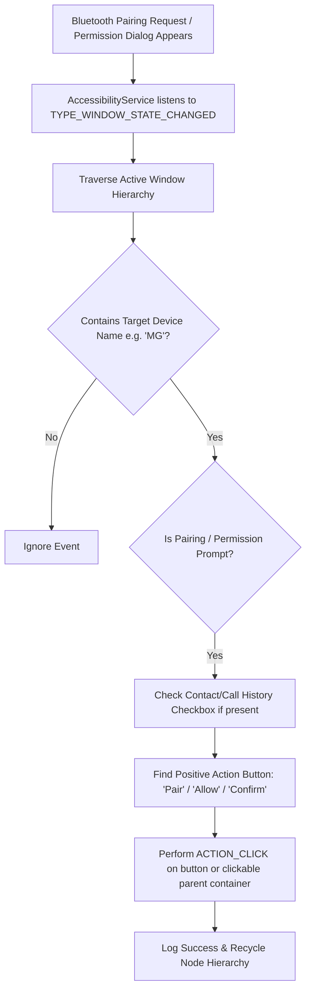

# MG Bluetooth Auto Pair 🚗📱

[-brightgreen)](https://developer.android.com/about/versions/pie)
[-blue)](https://developer.android.com/about/versions/14)
[](https://kotlinlang.org/)
[](https://developer.android.com/jetpack/compose)

An automated Android Accessibility Service that automatically detects and accepts Bluetooth pairing confirmation dialogs and contact/call log access requests from in-car infotainment systems (specifically targeting **MG** vehicles).

---

## 🛑 Problem Statement

Certain **MG car Bluetooth infotainment units** have a known firmware quirk where their Bluetooth MAC address changes dynamically upon vehicle restart/reboot. As a result, the phone treats every boot as a new device attempting to pair, triggering repeated Bluetooth pairing prompts and follow-up contact sharing permissions.

Having to manually unlock your phone and tap **Pair** and **Allow** every time you get into your car is inconvenient and unsafe while driving.

---

## ✨ Solution & Key Features

**MG Bluetooth Auto Pair** runs a background `AccessibilityService` (`BtAutoPairAccessibilityService`) that continuously monitors window events for pairing requests matching your vehicle's name.

- 🤖 **Automated Pairing Acceptance:** Detects pairing prompts containing `"MG"` (or your custom target device name) and automatically simulates an `ACTION_CLICK` on **Pair** / **Allow** / **Confirm**.
- 📇 **Automated Contact & Call Log Access:** Auto-checks *"Allow access to your contacts and call history"* checkboxes and approves follow-up contact sharing permission popups automatically.
- 📊 **Run Counter & Timestamp:** Tracks and displays how many times the service has auto-paired along with the exact date/time of the last action.
- 🧹 **Duplicate "MG" Bluetooth Device Cleanup:** Automatically unpairs leftover/stale `"MG"` entries from Bluetooth settings (both automatically after pairing and on-demand via a UI button).
- ⚙️ **Configurable Target Device Name:** Custom target device name (default: `MG`) saved persistently using **Preferences DataStore**.
- 🎨 **Modern Jetpack Compose UI:** Minimal single-activity dashboard displaying real-time service status (Active / Disabled).
- 🔓 **Android 13/14 Restricted Settings Guidance:** Built-in UI helper directing users through bypassing Android 13+ *"Restricted Setting"* security locks on sideloaded accessibility services.
- ⚡ **High Performance & Safe:** Safe tree traversal with explicit `AccessibilityNodeInfo` recycling to prevent memory leaks and a `500ms` debounce threshold for rapid back-to-back prompts.

---

## 🛠️ Architecture & Tech Stack

- **Language:** 100% Idiomatic Kotlin
- **UI:** Jetpack Compose with Material 3 Design
- **State & Storage:** Preferences DataStore & Kotlin Coroutines Flow
- **Build System:** Gradle Kotlin DSL (`build.gradle.kts`) with modern Version Catalog (`gradle/libs.versions.toml`)
- **Android API:** Accessibility Service (`AccessibilityNodeInfo`, `AccessibilityEvent`)

---

## 🚀 Setup & Installation Guide

### 1. Build and Sideload the APK

Clone the repository and install the debug APK to your device using Android Studio or ADB:

```bash
git clone https://github.com/YOUR_USERNAME/MG4BLEfix.git
cd MG4BLEfix
./gradlew assembleDebug
adb install -r app/build/outputs/apk/debug/app-debug.apk
```

### 2. Enable Restricted Settings (Android 13 & 14+)

On Android 13+ (API 33+), sideloaded apps have accessibility toggles greyed out by default (*"Restricted setting"*):

1. Open **MG Bluetooth Auto Pair** on your phone.
2. Tap **Open App Info** on the red warning card.
3. Tap the **3 dots (⋮)** in the top-right corner of the App Info screen.
4. Tap **Allow restricted settings** and authenticate via PIN/Fingerprint.

### 3. Activate the Accessibility Service

1. Open the **MG Bluetooth Auto Pair** app.
2. Tap **Enable Accessibility Service** (or go to *Settings > Accessibility > Downloaded Apps*).
3. Select **MG Bluetooth Auto Pair Service**.
4. Toggle the switch to **ON** and confirm the system dialog.
5. Re-open the app — the status card will display a green **Service Active** banner.

---

## 🔍 How It Works Under the Hood



---

## 🛡️ Privacy & Security Statement

- **Strict Target Filtering:** The app **only** interacts with system dialogs containing your specified target device name (default: `MG`).
- **100% Local Processing:** The app does not request Internet access (`android.permission.INTERNET` is omitted) and sends zero data off your device.
- **Open Source:** Full source code is available in this repository for audit and inspection.

---

## 📜 License

Distributed under the MIT License. See `LICENSE` for more information.
